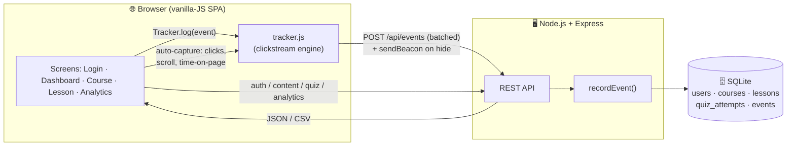
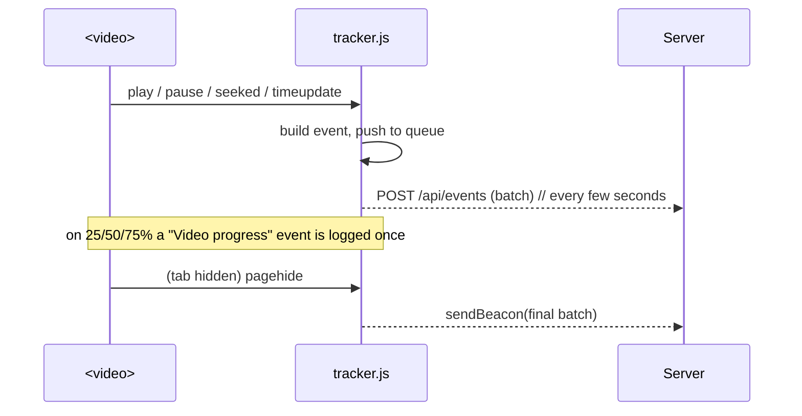

# LearnFlow — Architecture

This document explains **how LearnFlow is built** and, most importantly, **how the
clickstream flows** from a learner's browser into queryable, exportable data.

---

## 1. High-level overview



- **One process** serves both the static SPA and the JSON API on `http://localhost:3000`.
- **No client build step** — the browser loads plain `.js`/`.css`.
- **SQLite** is embedded; the DB is a single file under `data/`.

---

## 2. The clickstream pipeline (the core of the assignment)

### 2.1 Capture (client)

`public/js/tracker.js` is a self-contained module that does four jobs:

1. **Session identity** — mints a `session_id` (stored in `sessionStorage`) so every event
   in one browser session can be grouped.
2. **Semantic events** — the app calls `Tracker.log({...})` for meaningful actions
   (lesson viewed, video played, quiz answered, …), passing Moodle-style fields
   (`component`, `event_name`, `description`) plus machine fields (`event_type`, `target_*`).
3. **Automatic capture** — with zero per-element wiring it records:
   - **clicks** (global capture-phase listener on any link/button/card/option),
   - **scroll depth** (25/50/75/100% milestones, once each),
   - **time-on-page** (measured between route changes and on tab-hide).
4. **Reliable delivery** — events are pushed to an in-memory **queue** and flushed to
   `POST /api/events`:
   - in **batches** every few seconds or when the queue hits 25 events,
   - immediately via **`navigator.sendBeacon`** on `visibilitychange`/`pagehide`, so the
     final events survive a tab close,
   - failed batches are **re-queued** for the next flush.

### 2.2 Ingest & enrich (server)

`POST /api/events` accepts `{ events: [...] }`. For each event the server:

- resolves the **authenticated user** from the bearer token (events may also be anonymous,
  e.g. on the login screen),
- stamps the **real client IP** (`x-forwarded-for` aware),
- writes the row inside a single **transaction** for throughput.

Security-critical events (`login`, `logout`, `quiz submitted`) are **also** logged
server-side in `recordEvent()`, so the audit timeline doesn't depend on a cooperative client.

### 2.3 Store

All events land in the indexed **`events`** table (see the schema in
[`server/db.js`](../server/db.js)). Indexes on `user_id`, `event_type` and `time` keep the
analytics queries fast.

### 2.4 Read back

- **`/api/analytics/summary`** — aggregates: totals, events-per-day, counts by
  `event_name` and by `component`, quiz stats.
- **`/api/analytics/events`** — the most recent raw rows for the log table.
- **`/api/analytics/export.csv`** — streams the clickstream as CSV in the **exact Moodle
  column order** from the reference spreadsheet.

**Scope rule:** a `learner` sees only `WHERE user_id = <self>`; an `admin` sees everyone.
This is enforced in the SQL, not the UI.

---

## 3. Request lifecycle examples

### Logging in

```mermaid
sequenceDiagram
  participant B as Browser
  participant S as Server
  participant D as SQLite
  B->>S: POST /api/auth/login {email,password}
  S->>D: SELECT user; bcrypt.compare
  S->>D: INSERT session(token)
  S->>D: INSERT event "User logged in"
  S-->>B: { token, user }
  B->>B: store token, route to #/dashboard
```

### Watching a video



---

## 4. Data model

```mermaid
erDiagram
  users ||--o{ sessions : has
  users ||--o{ quiz_attempts : makes
  users ||--o{ events : generates
  courses ||--o{ lessons : contains
  lessons ||--o{ quiz_attempts : graded_by
  lessons ||--o{ events : context_of

  users { int id PK; string name; string email; string role }
  courses { int id PK; string slug; string title }
  lessons { int id PK; int course_id FK; string type; text body }
  quiz_attempts { int id PK; int user_id FK; int lesson_id FK; int score }
  events { int id PK; int user_id FK; string time; string component; string event_name; string description; string ip_address }
```

Lesson content is stored as JSON in `lessons.body`, keyed by `type`:
`text` → `{ html, keyPoints }`, `video` → `{ videoUrl, summary }`,
`quiz` → `{ passMark, questions:[{id, prompt, options, answer}] }`.
**Quiz answer keys are stripped** before a lesson is sent to a learner and grading happens
server-side.

---

## 5. Design decisions & trade-offs

| Decision | Why | Trade-off |
|---|---|---|
| Vanilla JS, no framework/build | Runs with one command; nothing to compile; robust live demo | More manual DOM code |
| SQLite (`better-sqlite3`) | Real relational store, zero setup, synchronous & fast | Single-writer (fine at this scale) |
| Token sessions in a table | Simple, revocable, no JWT signing infra | Server keeps session state |
| Batching + `sendBeacon` | Efficient network use; no lost tail events | Events are near-real-time, not instant |
| Moodle-shaped events | Output matches the reference sheet 1:1 | Slightly verbose descriptions |
| Local demo videos | Fully offline; no CDN dependency during grading | Small binaries committed to the repo |

---

## 6. Where to look in the code

| To understand… | Read… |
|---|---|
| The DB schema (incl. the clickstream) | [`server/db.js`](../server/db.js) |
| API + server-side event logging + CSV | [`server/index.js`](../server/index.js) |
| Demo users & course content | [`server/seed.js`](../server/seed.js) |
| **The clickstream engine** | [`public/js/tracker.js`](../public/js/tracker.js) |
| Screens, routing & video/quiz wiring | [`public/js/app.js`](../public/js/app.js) |
